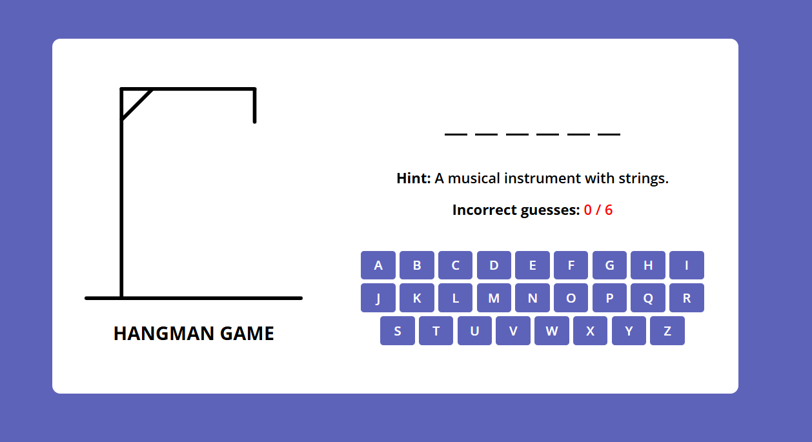

# Hangman Game

A simple browser-based Hangman game built with HTML, CSS, and JavaScript. The player guesses letters to reveal a hidden word before running out of chances. Each round includes a hint and a dynamic keyboard, with a win/lose modal and responsive layout.

## Example

<p align="center">
    
</p>

## Demo

Open the project in your browser to play locally, or deploy the site with GitHub Pages to share it online.

## Features

- Random word selection from a built-in word list
- Hint displayed for each round
- Keyboard-based letter input
- Hangman illustration that updates after each wrong guess
- Win and lose modal notifications
- Responsive UI for desktop and mobile screens
- Lightweight front-end project with no build step required

## Project Structure

```text
hangman/
├── index.html
├── style.css
├── images/
│   ├── hangman-0.svg
│   ├── hangman-1.svg
│   ├── hangman-2.svg
│   ├── hangman-3.svg
│   ├── hangman-4.svg
│   ├── hangman-5.svg
│   ├── hangman-6.svg
│   ├── lost.gif
│   └── victory.gif
├── scripts/
│   ├── script.js
│   └── word-list.js
└── README.md
```

## How to Run Locally

1. Clone or download this repository.
2. Open the project folder.
3. Launch `index.html` in a browser.

You can also serve it locally with a simple HTTP server:

```bash
cd hangman
python -m http.server 8000
```

Then visit:

```text
http://localhost:8000
```

## GitHub Pages Deployment

To publish this project on GitHub Pages:

1. Push the repository to GitHub.
2. Open the repository in GitHub.
3. Go to `Settings` -> `Pages`.
4. Under `Source`, select the branch to publish (for example `main` or `master`).
5. Choose the root folder (`/`) as the publishing source.
6. Save the settings.

GitHub will provide a live URL for your game once the site is published.

## Technologies Used

- HTML
- CSS
- JavaScript

## License

This project is open for personal and educational use.

## Author

Built as a small front-end game project for practice and learning.
